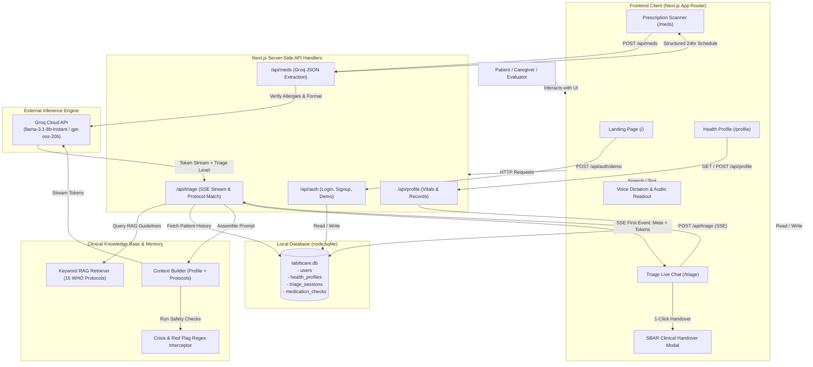
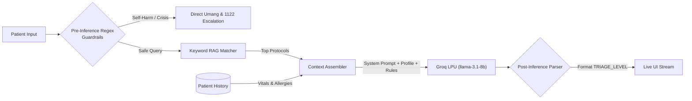

# TabeebCare (طبیب کیئر) AI for Accessible Healthcare & Well-Being

[](https://tabeeb-care.vercel.app)
[](https://sdgs.un.org/goals/goal3)
[](https://nextjs.org/)
[](https://groq.com/)
[](https://sqlite.org/)
[](https://tailwindcss.com/)
[](https://www.typescriptlang.org/)

> **Seekers Tech & Computing Society (STCS) • Student Week 2026**  
> **Minhaj University Lahore • AI Hackathon & Startup Pitch**  
> Challenge Track: **United Nations SDG 3 — Good Health and Well-Being**  
> Official Repository: [https://github.com/muhammadali382/SDG_03](https://github.com/muhammadali382/SDG_03)  
> Live Deployment: [https://tabeeb-care.vercel.app](https://tabeeb-care.vercel.app)

---

## 📑 Table of Contents
1. [Project Overview](#-1-project-overview)
2. [Problem Statement](#-2-problem-statement)
3. [Key Features](#-3-key-features)
4. [Technology Stack](#-4-technology-stack)
5. [System Architecture](#-5-system-architecture)
6. [Project Structure](#-6-project-structure)
7. [Installation and Setup](#-7-installation-and-setup)
8. [Environment Variables](#-8-environment-variables)
9. [API Documentation](#-9-api-documentation)
10. [AI Agent Architecture & Safety Guardrails](#-10-ai-agent-architecture--safety-guardrails)
11. [Screenshots & 60-Second Demo Script](#-11-screenshots--60-second-demo-script)
12. [Security and Medical Disclaimer](#-12-security-and-medical-disclaimer)
13. [Current Limitations & Future Roadmap](#-13-current-limitations--future-roadmap)
14. [Contributing](#-14-contributing)
15. [License and Acknowledgements](#-15-license-and-acknowledgements)

---

## 🏥 1. Project Overview

**TabeebCare (طبیب کیئر)** is an intelligent, culturally-attuned, bilingual healthcare literacy and triage navigation assistant developed for Pakistani patients and resource-constrained health systems. Built in alignment with **United Nations Sustainable Development Goal 3 (Good Health and Well-Being)**, the platform demystifies complex prescriptions into intuitive 24-hour visual timetables, stratifies acute symptoms into clinical urgency tiers using WHO-inspired clinical protocols, and creates one-click clinical handover summaries (SBAR) to bridge communication gaps between patients and physicians.

### Why TabeebCare Was Developed
In primary care settings across developing countries, low health literacy, language barriers, and extreme doctor-patient shortages lead to preventable medication errors and delayed emergency care. TabeebCare acts as a pre-consultation navigator and post-consultation educator, translating confusing medical terminology into actionable guidance in **English**, **Urdu (اردو)**, and **Roman Urdu**.

### Intended Users
- **Patients & Families**: Outpatients navigating multi-drug prescriptions, chronic conditions (e.g., Diabetes, Hypertension), or acute symptom flare-ups.
- **Caregivers & Eldercare Providers**: Family members managing medication schedules and monitoring warning signs for elderly dependents.
- **Primary Care Physicians**: Doctors receiving structured, concise SBAR handover notes from patients during brief 3-minute consultations.

---

## 🔍 2. Problem Statement

TabeebCare directly tackles four systemic healthcare delivery challenges:

1. **Prescription Misunderstanding & Medication Non-Adherence**:
   Patients frequently struggle to decipher handwritten prescriptions, distinguish between brand and generic compounds, or remember timing instructions. This leads to missed doses, inappropriate drug combinations, and treatment failures.
2. **Medication Clashes & Allergy Risks**:
   Patients often forget to disclose known allergies (e.g., Penicillin) or chronic conditions to prescribing doctors, resulting in dangerous cross-reactive dispensing (e.g., Co-amoxiclav prescribed to a penicillin-allergic patient).
3. **Emergency Triage Uncertainty**:
   Individuals often cannot differentiate between benign self-limiting illness and life-threatening red flags (such as atypical cardiac pain, stroke FAST indicators, or pediatric dehydration). This causes avoidable deaths from delayed care or unnecessary crowding of tertiary emergency rooms.
4. **The 3-Minute Consultation Gap**:
   Due to heavy patient loads, primary care outpatient visits often last under 3 minutes. Rushed consultations leave little time for doctors to capture longitudinal medical histories or for patients to clearly convey their symptoms.

---

## ⚡ 3. Key Features

### 💊 Module 1: Medicine Demystifier & Prescription Literacy (`/meds`)
- **Prescription Ingestion**: Accepts comma-separated brand or generic medicine names (e.g., `Augmentin 625mg, Panadol 500mg, Metformin 500mg`).
- **Visual 24-Hour Dosing Schedule**: Categorizes daily dosing into an intuitive four-phase visual routine:
  - 🌅 **Morning (صبح)**
  - ☀️ **Afternoon (دوپہر)**
  - 🌇 **Evening (شام)**
  - 🌙 **Night (رات)**
- **Bilingual Purpose & Food Guidance**: Explains what each drug is for and how to take it (e.g., *"Take with food or a glass of milk to reduce stomach upset"*) in both clear English and natural Urdu script (اردو).
- **Automated Allergy Conflict Sentinel**: Cross-references every analyzed medication against the patient's recorded drug allergies (e.g., Penicillin, Sulfa) and fires prominent conflict alerts.
- **Pre-Configured Clinical Demo Presets**:
  - *Diabetes Routine*: `Metformin 500mg, Glibenclamide 5mg, Aspirin 75mg`
  - *Antibiotic Course (Allergy Conflict Test)*: `Augmentin 625mg, Panadol 500mg` (triggers Penicillin alert)
  - *Hypertension Regimen*: `Amlodipine 5mg, Losartan 50mg, Hydrochlorothiazide 25mg`

### 🩺 Module 2: Multilingual Clinical Symptom Triage (`/triage`)
- **Multilingual Conversational Intake**: Accepts natural symptom descriptions in **Urdu (اردو)**, **Roman Urdu** (*"Mujhe 2 din se tez bukhar hai"*), or **English**.
- **Server-Sent Events (SSE) Streaming**: Low-latency token generation via Groq Cloud LPU inference (`openai/gpt-oss-20b` / `llama-3.1-8b-instant`).
- **4-Tier Urgency Stratification**:
  - 🚨 **Emergency**: Immediate life hazard requiring 1122 transfer (e.g., chest pain, stroke symptoms).
  - ⚠️ **Urgent**: High-priority symptoms requiring same-day clinic consultation.
  - ℹ️ **Routine**: Non-critical symptoms suitable for an outpatient clinic visit within 2–3 days.
  - 🟢 **Home Care**: Self-limiting minor illness managed with rest, hydration, and monitoring.
- **WHO-Inspired Clinical Protocol RAG**: Grounds assessments in 15 evidence-based primary care guidelines using weighted keyword retrieval.
- **RAG Explainability Modal ("Why this result? / وجہ جانیں")**: Transparently displays matched protocols, matched keywords, severity, and considered patient profile factors.

### 🚨 Module 3: Emergency & Crisis Intervention
- **Dynamic Emergency Action Banners**: Renders prominently only on `emergency` or `urgent` triage levels:
  - 📞 **Call 1122**: Direct `tel:1122` one-click call to Rescue 1122 emergency services.
  - 🏥 **Nearest Emergency Hospital**: Direct Google Maps geolocation link to nearby emergency facilities.
- **Mental Health & Self-Harm Guardrail**: Instant pre-inference regex interceptor detects self-harm/crisis signals in Urdu, Roman Urdu, and English, providing immediate links to **Umang Mental Health Helpline (0317-4288665)** and emergency psychiatrist mapping.

### 🎙️ Module 4: Bilingual Voice Input & Audio Readout
- **Voice Dictation (`VoiceButton`)**: Web Speech API (`webkitSpeechRecognition`) supporting real-time speech-to-text with quick toggle between Pakistani Urdu (`ur-PK`) and English (`en-US`).
- **Audio Readout (`AudioReadoutButton`)**: Browser SpeechSynthesis with automatic Urdu script detection (`/[\u0600-\u06FF]/`) to vocalize clinical advice for low-literacy patients.

### 📋 Module 5: Clinical Handover Card (SBAR)
- **Standardized Medical Summary**: Generates a 1-click **SBAR** report (**S**ituation, **B**ackground, **A**ssessment, **R**ecommendation).
- **Bilingual & Exportable**: Language toggle between English and Urdu with one-click `.txt` file download to present to the doctor during clinic visits.

### 👤 Module 6: Longitudinal Health Profile (`/profile` & `/dashboard`)
- **Local SQLite Storage**: Manages patient vitals, chronic conditions, drug/food allergies, and active medications in SQLite (`tabibcare.db`).
- **Instant Demo Login**: Ahmad Khan (54-year-old male, Type 2 Diabetes, Hypertension, Penicillin & Sulfa allergies) available with 1 click for instant evaluation.

---

## 🛠️ 4. Technology Stack

| Layer | Technology | Purpose & Implementation Details |
|:---|:---|:---|
| **Frontend Framework** | **Next.js 14 / 15 (App Router)** | Server Components, Client Components, and responsive layouts |
| **Language** | **TypeScript 5.x** | Static type safety across frontend and API route handlers |
| **Styling & Theme** | **Tailwind CSS 3.4** | Accessible light theme (`teal-600`, `slate-50`, `white`), zero dark theme |
| **Icons** | **Lucide React** | Consistent, lightweight SVG iconography |
| **Backend API** | **Next.js Route Handlers (Node.js)** | Server-side endpoints (`/api/auth/*`, `/api/meds`, `/api/triage`, `/api/profile`) |
| **Database** | **SQLite (`node:sqlite`)** | Built-in native Node.js `DatabaseSync` engine (`tabibcare.db`) — zero external DB dependencies |
| **AI Inference** | **Groq Cloud API (`groq-sdk`)** | High-speed LLM inference (`openai/gpt-oss-20b` / `llama-3.1-8b-instant`) |
| **Clinical Knowledge Base** | **In-Memory RAG** | 15 WHO-inspired clinical protocol chunks with keyword matching |
| **Voice & Speech** | **Web Speech API** | Browser-native `SpeechRecognition` and `SpeechSynthesis` |
| **Authentication** | **Prototype Auth** | `localStorage` session state (`tabibcare_user`) + SQLite `users` table |
| **Deployment Target** | **Vercel** | Edge network and serverless functions (`tabeeb-care.vercel.app`) |

---

## 🏗️ 5. System Architecture



---

## 📂 6. Project Structure

```
SDG_03/
├── .agents/
│   └── AGENTS.md                    # Core project identity, design system, and constraints
├── .github/
│   └── workflows/
│       └── ci.yml                   # CI/CD pipeline: lint, type-check, and build on Node 22
├── src/
│   ├── app/                         # Next.js App Router
│   │   ├── (pages)/
│   │   │   ├── dashboard/page.tsx   # Authenticated patient portal and vitals summary
│   │   │   ├── login/page.tsx       # Prototype user login and 1-click Demo button
│   │   │   ├── meds/page.tsx        # Prescription demystifier and allergy sentinel
│   │   │   ├── profile/page.tsx     # Patient medical history editor
│   │   │   ├── signup/page.tsx      # Patient account registration
│   │   │   ├── triage/page.tsx      # Live triage chat, voice input, emergency alerts
│   │   │   ├── layout.tsx           # Global HTML wrapper, UserProvider, Navbar, Footer
│   │   │   └── page.tsx             # Interactive landing page and feature highlights
│   │   ├── api/                     # Server-Side API Handlers
│   │   │   ├── auth/
│   │   │   │   ├── demo/route.ts    # Instant evaluator login (Ahmad Khan, id: 999)
│   │   │   │   ├── login/route.ts   # Plaintext credential lookup
│   │   │   │   └── signup/route.ts  # User and health profile initialization
│   │   │   ├── meds/route.ts        # Groq JSON prescription parser and allergy check
│   │   │   ├── profile/route.ts     # Health profile retrieve and update
│   │   │   └── triage/route.ts      # SSE streaming triage consultation and RAG metadata
│   │   └── globals.css              # Tailwind CSS directives and custom scrollbar styling
│   ├── components/                  # Modular React UI Components
│   │   ├── layout/
│   │   │   ├── Footer.tsx           # Responsive footer with national emergency hotlines
│   │   │   ├── MedicalDisclaimer.tsx# Educational disclaimer modal and banner
│   │   │   └── Navbar.tsx           # Navigation bar with language switcher (EN / اردو)
│   │   ├── meds/
│   │   │   └── MedicineCard.tsx     # 24-hour visual schedule and allergy warning chip
│   │   ├── triage/
│   │   │   ├── ChatBubble.tsx       # Message bubble with markdown and audio playback
│   │   │   ├── CrisisGuardrailBanner.tsx # Self-harm intervention and Umang helpline
│   │   │   ├── EmergencyBanner.tsx  # Dynamic emergency banner with 1122 and Google Maps
│   │   │   ├── ExplainabilityModal.tsx # "Why this level?" clinical RAG explanation
│   │   │   ├── SbarCard.tsx         # Standardized SBAR doctor handover summary
│   │   │   └── TriageBadge.tsx      # Urgency level pill (Emergency, Urgent, Routine, Home)
│   │   └── ui/
│   │       ├── AudioReadoutButton.tsx # SpeechSynthesis reader with Urdu script detection
│   │       ├── Badge.tsx            # Variant badge component (primary, warning, emergency)
│   │       ├── Button.tsx           # Standardized button with loading state
│   │       ├── Card.tsx             # Card container primitives
│   │       ├── Input.tsx            # Form input field with error messaging
│   │       ├── MarkdownRenderer.tsx # Custom markdown parser with emergency highlights
│   │       └── VoiceButton.tsx      # Web Speech API mic button with ur-PK / en-US toggle
│   ├── context/
│   │   └── UserContext.tsx          # React Context: auth state, active profile, i18n
│   └── lib/                         # Server & Application Utilities
│       ├── db.ts                    # SQLite database singleton (node:sqlite)
│       ├── groq.ts                  # Groq Cloud SDK client instance
│       ├── guardrails.ts            # Client & server regex crisis and red-flag guardrails
│       ├── schema.ts                # Database DDL: users, profiles, sessions, meds
│       ├── i18n/
│       │   └── translations.ts      # Bilingual English/Urdu translation dictionary
│       ├── memory/
│       │   └── context_builder.ts   # System prompt assembler (Profile + RAG + Safety)
│       ├── prompts/
│       │   ├── meds_prompt.ts       # Structured JSON prompt for medicine parsing
│       │   └── triage_prompt.ts     # Clinical triage system instructions
│       └── rag/
│           ├── clinical_protocols.ts# 15 WHO-inspired clinical protocol chunks
│           └── retriever.ts         # In-memory keyword scorer and context extractor
├── .env.example                     # Environment variable template
├── next.config.mjs                  # Next.js build configuration
├── package.json                     # Project dependencies and script definitions
├── postcss.config.js                # PostCSS configuration for Tailwind CSS
├── tailwind.config.js               # Tailwind design system configuration
└── tsconfig.json                    # TypeScript compiler configuration
```

---

## 🚀 7. Installation and Setup

### Prerequisites
- **Node.js**: `v20.x` or `v22.x` (Node 22 is recommended for native `node:sqlite`)
- **npm**: `v10.x` or higher
- **Groq Cloud API Key**: Free tier available from [console.groq.com](https://console.groq.com)

### 1. Clone the Repository
```bash
git clone https://github.com/muhammadali382/SDG_03.git
cd SDG_03

# Ensure you are on the primary branch
git checkout dev
```

### 2. Install Dependencies
```bash
npm install
```

### 3. Configure Environment Variables
Create a `.env.local` file in the project root:
```bash
cp .env.example .env.local
```
Add your Groq API key:
```env
# Groq Cloud API Key (Required)
GROQ_API_KEY=gsk_your_groq_api_key_here

# Groq Model Selection (Optional - defaults to openai/gpt-oss-20b)
GROQ_MODEL=openai/gpt-oss-20b
```

### 4. Run the Development Server
```bash
npm run dev
```
Open [http://localhost:3000](http://localhost:3000) in your web browser.

### 5. Verify Build and TypeScript Types
```bash
# Verify TypeScript compiles with zero errors
npx tsc --noEmit

# Verify production build succeeds
npm run build
```

---

## 🔐 8. Environment Variables

| Variable | Description | Default Value | Required |
|:---|:---|:---|:---:|
| `GROQ_API_KEY` | Authentication key for Groq Cloud LLM API | *None* | **Yes** |
| `GROQ_MODEL` | LLM model identifier on Groq Cloud | `openai/gpt-oss-20b` | No |
| `NODE_ENV` | Runtime environment mode | `development` | No |

---

## 📡 9. API Documentation

### 1. Instant Evaluator Demo Login
* **Endpoint**: `POST /api/auth/demo`
* **Purpose**: Generates an in-memory session for the demo persona (Ahmad Khan) without database side-effects.
* **Request**: No body required.
* **Response (`200 OK`)**:
```json
{
  "success": true,
  "user": {
    "id": 999,
    "name": "Ahmad Khan (احمد خان)",
    "email": "ahmad.demo@tabeebcare.pk",
    "isDemo": true
  },
  "profile": {
    "age": 54,
    "gender": "Male",
    "conditions": ["Type 2 Diabetes", "Hypertension"],
    "allergies": ["Sulfa", "Penicillin"],
    "current_medications": ["Metformin 500mg", "Amlodipine 5mg"]
  }
}
```

---

### 2. Medication Demystifier & Allergy Check
* **Endpoint**: `POST /api/meds`
* **Purpose**: Analyzes free-text medications, generates 24-hr schedules, and checks for allergy conflicts.
* **Request**:
```json
{
  "medications": "Augmentin 625mg, Panadol 500mg",
  "userId": 999
}
```
* **Response (`200 OK`)**:
```json
{
  "success": true,
  "data": {
    "medications": [
      {
        "name": "Augmentin 625mg",
        "generic": "Amoxicillin / Clavulanic Acid",
        "purpose": "Treats bacterial infections.",
        "purpose_urdu": "بیکٹیریائی انفیکشن کا علاج کرتا ہے۔",
        "schedule": {
          "morning": true,
          "afternoon": false,
          "evening": true,
          "night": false
        },
        "food_instruction": "Take with food to reduce stomach upset.",
        "food_instruction_urdu": "کھانے کے ساتھ لیں تاکہ معدے میں تکلیف نہ ہو۔",
        "warnings": ["Complete the full course even if feeling better."],
        "allergy_conflict": true,
        "allergy_message": "**Allergy to Penicillin detected. Do NOT take Augmentin.**"
      },
      {
        "name": "Panadol 500mg",
        "generic": "Acetaminophen (Paracetamol)",
        "purpose": "Relieves pain and reduces fever.",
        "purpose_urdu": "درد اور بخار کو کم کرتا ہے۔",
        "schedule": {
          "morning": true,
          "afternoon": true,
          "evening": false,
          "night": false
        },
        "food_instruction": "Can be taken with or without food.",
        "food_instruction_urdu": "کھانے کے ساتھ یا بغیر لے سکتے ہیں۔",
        "warnings": ["Do not exceed 8 tablets in 24 hours."],
        "allergy_conflict": false,
        "allergy_message": null
      }
    ],
    "general_advice": "Always finish the full antibiotic course.",
    "general_advice_urdu": "ہمیشہ اینٹی بائیوٹک کا مکمل کورس پورا کریں۔"
  }
}
```

---

### 3. Symptom Triage Consultation (Server-Sent Events)
* **Endpoint**: `POST /api/triage`
* **Purpose**: Evaluates patient symptoms against clinical RAG protocols, streams live reasoning, and assigns an urgency tier.
* **Request**:
```json
{
  "messages": [
    { "role": "user", "content": "I have sudden crushing chest pain and shortness of breath." }
  ],
  "userId": 999
}
```
* **Response Stream**:
```http
HTTP/1.1 200 OK
Content-Type: text/plain; charset=utf-8
Transfer-Encoding: chunked

data: {"type":"meta","protocols":[{"id":"cv-01","title":"Adult Chest Pain & Acute Coronary Syndrome"}],"matchedKeywords":["chest pain","shortness of breath"],"severity":"emergency","profileUsed":{"conditions":["Type 2 Diabetes","Hypertension"],"allergies":["Sulfa","Penicillin"]}}

TRIAGE_LEVEL: emergency

This is a medical emergency. Your symptoms indicate possible cardiac ischemia. Please call 1122 immediately and proceed to the nearest emergency department.
```

---

### 4. Health Profile Management
* **Endpoint**: `GET /api/profile?userId=1` & `POST /api/profile`
* **Purpose**: Retrieves or updates the patient's age, gender, chronic conditions, and recorded allergies.
* **POST Request**:
```json
{
  "userId": 1,
  "age": 45,
  "gender": "Female",
  "conditions": ["Asthma"],
  "allergies": ["Aspirin"],
  "current_medications": ["Ventolin Inhaler"]
}
```

---

## 🤖 10. AI Agent Architecture & Safety Guardrails

TabeebCare employs a specialized multi-agent architecture with strict clinical boundary safeguards:



### Safety & Guardrail Features:
1. **Pre-Inference Interceptor (`src/lib/guardrails.ts`)**: Evaluates incoming text before invoking the LLM. Detects suicidal ideation, self-harm, or severe acute emergencies across English, Roman Urdu (`"mar lu ga"`, `"khud kushi"`), and Urdu text.
2. **Deterministic Fallbacks**: If network interruption occurs, the client automatically falls back to an emergency advisory instructing immediate contact with Rescue 1122.
3. **No Definitive Diagnosing**: Prompt engineering explicitly prohibits the model from making definitive medical assertions. The agent uses educational phrasing: *"These symptoms may indicate [Possibility] and require evaluation by a physician."*
4. **Allergy Conflict Enforcement**: When cross-referencing prescriptions, the agent checks beta-lactam and sulfonamide classes against patient records, providing immediate warnings against contraindicated intake.

---

## 📸 11. Screenshots & 60-Second Demo Script

### ⏱️ 60-Second Live Evaluation Script for Judges
1. **Step 1: Instant Login**  
   Visit `/login` and click **"⚡ Instant Judge Demo Login"**. Ahmad Khan's profile (54-year-old male, Type 2 Diabetes, Hypertension, Penicillin allergy) is loaded immediately.
2. **Step 2: Prescription Scanning (`/meds`)**  
   Click the **"Antibiotic Course"** preset (`Augmentin 625mg, Panadol 500mg`) and click **"Analyze Prescriptions"**.  
   *Result*: A visual 24-hour schedule appears alongside a **bold red Penicillin allergy conflict alert**.
3. **Step 3: Clinical Triage (`/triage`)**  
   Click the starter chip: **"Crushing Chest Pain & Breathing"**.  
   *Result*: The response streams in real time, assigning `TRIAGE_LEVEL: emergency`, displaying the **Call 1122** button, **Nearest Hospital** map link, and an explainability chip explaining the matched WHO protocol.
4. **Step 4: Voice & SBAR Handover**  
   Test the speaker readout via the **AudioReadoutButton**, then click **"Doctor Card (SBAR)"** to view and download the bilingual clinical handover report.

### 🖼️ Application Interface Captures
| View | Description |
|:---|:---|
| **Prescription Demystifier (`/meds`)** | Visual 24-hr dosing timeline, food instructions, and allergy warning badges |
| **Symptom Triage (`/triage`)** | Live SSE chat, WHO protocol explainability modal, and emergency action banners |
| **Doctor Handover Card (SBAR)** | Structured Situation, Background, Assessment, and Recommendation modal with text export |
| **Patient Profile (`/profile`)** | Chronic condition management and drug allergy records stored in SQLite |

---

## 🔒 12. Security and Medical Disclaimer

### Data Security & Privacy
- **Local SQLite Engine**: All persistent data is stored in the local SQLite database (`tabibcare.db`) or local device storage.
- **No External Data Brokerage**: Patient records are never sold, indexed, or shared with third-party tracking services.
- **Client-Side Storage**: Active session credentials and user profile caches reside securely in the browser's `localStorage`.

### Mandatory Medical Disclaimer
> **Medical Disclaimer**: TabeebCare is an educational health literacy, prescription demystifier, and triage navigation tool. It does not replace professional medical advice, formal clinical diagnosis, or emergency medical treatment. Users should always consult qualified healthcare providers for medical decisions. If you suspect a life-threatening medical emergency, call **1122** or visit the nearest emergency department immediately.

---

## 🗺️ 13. Current Limitations & Future Roadmap

### Implemented Functionality ✅
- Free-text prescription parsing into 4-phase visual dosing schedules (Morning, Afternoon, Evening, Night).
- Automated drug allergy conflict alerts (e.g., Penicillin cross-reactivity).
- Real-time conversational triage streaming with line-1 urgency classification.
- In-memory RAG grounding over 15 primary care protocols.
- Trilingual crisis and self-harm detection with Umang Helpline referral (0317-4288665).
- Web Speech API microphone dictation (`ur-PK` / `en-US`) and text-to-speech readout.
- Bilingual SBAR clinical handover card generation and text export.
- Full RTL layout support for Urdu script.

### Known Limitations ⚠️
- Prescriptions must currently be typed or pasted as text (OCR scanning is planned for a future release).
- SQLite storage is local to the instance and not distributed across multi-region server clusters.
- Voice recognition accuracy depends on browser Web Speech API support.

### Future Roadmap 🔮
- **Mobile Camera Prescription OCR**: Integration of offline on-device document OCR to digitize doctor prescriptions directly from phone cameras.
- **Offline Protocol Sync**: Progressive Web App (PWA) offline caching for triage guidance in remote areas with zero internet connectivity.
- **Direct EHR / EMR Integration**: FHIR-compliant export of SBAR handover notes directly into Pakistani hospital management systems.

---

## 🤝 14. Contributing

Contributions are welcome! Please follow these steps:

1. **Fork the Repository**: Click the **Fork** button on GitHub.
2. **Create a Feature Branch**:
   ```bash
   git checkout -b feature/your-feature-name
   ```
3. **Commit Your Changes**: Follow present-tense commit message conventions:
   ```bash
   git commit -m "Add feature name or fix description"
   ```
4. **Push to the Branch**:
   ```bash
   git push origin feature/your-feature-name
   ```
5. **Open a Pull Request**: Submit your pull request against the `dev` branch for review.

---

## 📜 15. License and Acknowledgements

### License
This project was developed as a competition submission for the **Seekers Tech & Computing Society (STCS) Student Week 2026 AI Hackathon** at Minhaj University Lahore. The license has not yet been specified; all rights are currently reserved by the original authors.

### Acknowledgements
- **Minhaj University Lahore & Seekers Tech & Computing Society (STCS)** for organizing the Student Week 2026 AI Hackathon.
- **United Nations Sustainable Development Goals (SDG 3)** for providing the mission framework for accessible primary healthcare.
- **Groq Cloud** for high-speed LPU inference capabilities.
- **Next.js & Vercel** for the modern App Router architecture.
